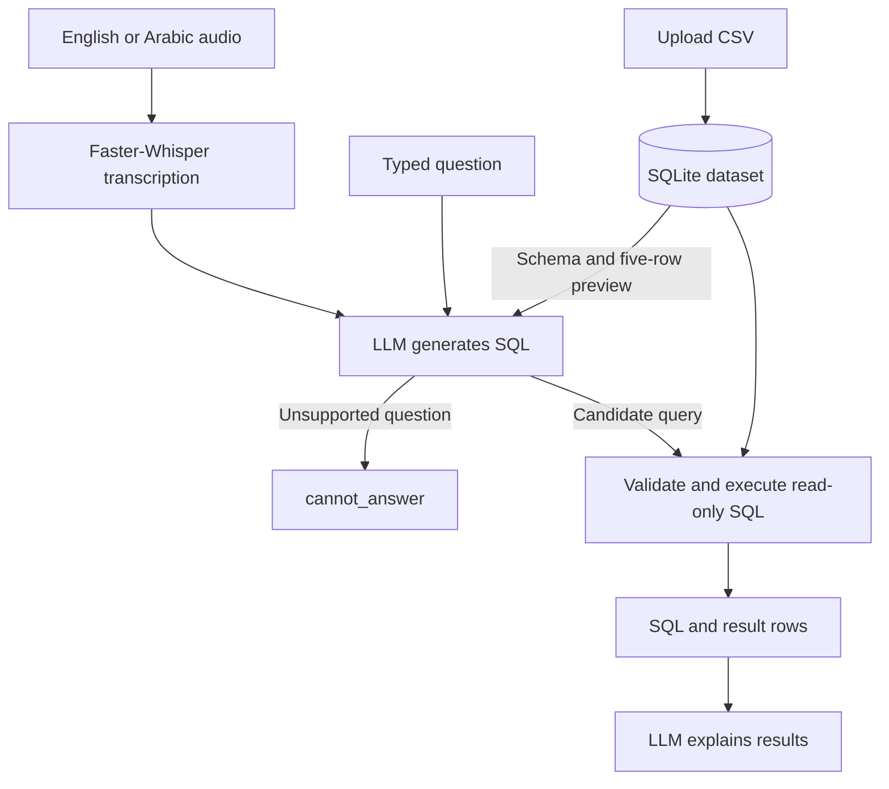

# Voice-Based Data Analysis API

Ask questions about a CSV dataset in **English or Arabic**, using text or a voice recording. The API transcribes speech, generates a SQLite query, validates and executes it, and returns the results with an explanation.

**Author:** Nafe Abubaker  
**Project:** Cellula Technologies — Week 5 / Task 5

## Overview

This project implements the voice-based data analysis workflow for Project 2, Part 2 using FastAPI. A user uploads a CSV, receives a dataset ID, and asks questions about that dataset through the API.

The LLM generates SQL and explains returned results. **Python's built-in `sqlite3` executes the query and calculates the results.** Faster-Whisper transcribes audio locally.

| Capability | Implementation |
| --- | --- |
| Dataset upload | UTF-8 CSV import, inferred column types, and a five-row preview |
| Dataset storage | A separate SQLite database for each upload |
| Text analysis | English and Arabic questions converted into SQL |
| Voice analysis | Audio transcription followed by the same analysis workflow |
| Query controls | SQLGlot validation, read-only SQLite connections, and an authorizer |
| Result explanation | A short explanation based on the executed query and returned rows |
| Unsupported requests | A `cannot_answer` response when the model identifies an unrelated or unsupported question |
| Interactive testing | FastAPI's Swagger UI at `/docs` |

## Workflow



The preview helps the model interpret column values. Calculations run against the **full uploaded table**, subject to the query's filters. The preview does not limit the calculation to five rows.

## Technology stack

| Component | Technology | Purpose |
| --- | --- | --- |
| API | FastAPI and Uvicorn | Request handling, validation, and API documentation |
| CSV processing | pandas | Read CSV files and create the SQLite table |
| Speech recognition | Faster-Whisper with CTranslate2 | Transcribe English and Arabic audio |
| Language model access | OpenRouter through HTTPX | Generate SQL and explain query results |
| SQL inspection | SQLGlot | Parse SQL and check column references |
| Database execution | Python `sqlite3` | Store uploaded data and execute queries |
| Configuration | python-dotenv | Load local environment settings |

The tested environment uses **Windows and Python 3.11.9**. `requirements.txt` records the installed package versions from that working environment.

## Run locally

### 1. Create a virtual environment

Download or clone this repository, open its root folder in **Windows Command Prompt**, and run:

```bat
py -3.11 -m venv .venv
.venv\Scripts\activate
```

### 2. Install dependencies

```bat
python -m pip install -r requirements.txt
python -m pip check
```

The dependency check should report:

```text
No broken requirements found.
```

### 3. Configure the models

Create a file named `.env` beside `main.py`:

```dotenv
OPENROUTER_API_KEY=your_openrouter_api_key
OPENROUTER_MODEL=qwen/qwen3-coder
WHISPER_MODEL=small
```

| Setting | Meaning |
| --- | --- |
| `OPENROUTER_API_KEY` | API key used for OpenRouter requests |
| `OPENROUTER_MODEL` | Model identifier used for SQL generation and explanations |
| `WHISPER_MODEL` | Speech model; defaults to the multilingual `small` model |

`qwen/qwen3-coder` is the model used during testing. OpenRouter model availability and pricing can change; check the [model page](https://openrouter.ai/qwen/qwen3-coder) for current details.

The speech model runs on the CPU with `int8` computation. Its first use downloads model files into `data/models/whisper/`; later runs reuse those files. Internet access is needed for that initial download and for OpenRouter requests. Restart the API after changing `.env`.

### 4. Start the API

```bat
python -m uvicorn main:app --reload --host 127.0.0.1 --port 8000
```

| Address | Purpose |
| --- | --- |
| [http://127.0.0.1:8000/docs](http://127.0.0.1:8000/docs) | Interactive Swagger UI |
| [http://127.0.0.1:8000/health](http://127.0.0.1:8000/health) | API health check |

The health endpoint returns `{"status": "ok"}`. It checks that the API responds; it does not test OpenRouter or load the speech model. The root URL `/` has no homepage and returns `404`.

## Upload a dataset

Create `sample_sales.csv` with the following contents, or use another UTF-8 CSV with a header row:

```csv
order_id,city,product,quantity,unit_price
1,Ramallah,Laptop,1,900
2,Nablus,Mouse,3,20
3,Ramallah,Keyboard,2,50
4,Hebron,Mouse,5,20
5,Nablus,Laptop,1,900
6,Hebron,Keyboard,1,50
```

In Swagger UI:

1. Expand **POST `/datasets`** and click **Try it out**.
2. Select the CSV in the `file` field and click **Execute**.
3. Copy the returned `dataset_id` for subsequent requests.

A successful upload returns HTTP `201` with `status: "uploaded"`, a dataset ID, the table name `dataset`, column names and types, the total row count, and a preview of up to five rows.

Each upload creates a new database at:

```text
data/datasets/<dataset_id>.sqlite3
```

The CSV's data is stored in the SQLite table. The original CSV file is not copied into this directory. Use **GET `/datasets/{dataset_id}`** to retrieve the stored schema, row count, and preview later.

## Analyze a text question

Use **POST `/analyze/text`** with a JSON body. Replace `YOUR_DATASET_ID` with the ID returned by your own upload:

```json
{
  "dataset_id": "YOUR_DATASET_ID",
  "question": "What is the total sales value for each city?"
}
```

For the sample dataset, a successful response has this structure. The ID is shown as a placeholder; SQL formatting and explanation wording may vary between model responses.

```json
{
  "status": "analyzed",
  "dataset_id": "YOUR_DATASET_ID",
  "sql": "SELECT city, SUM(quantity * unit_price) AS total_sales_value FROM dataset GROUP BY city;",
  "columns": ["city", "total_sales_value"],
  "rows": [
    {"city": "Hebron", "total_sales_value": 150},
    {"city": "Nablus", "total_sales_value": 960},
    {"city": "Ramallah", "total_sales_value": 1000}
  ],
  "row_count": 3,
  "truncated": false,
  "question": "What is the total sales value for each city?",
  "explanation": "Hebron has total sales of 150, Nablus has 960, and Ramallah has 1000.",
  "explanation_status": "generated"
}
```

Arabic questions use the same endpoint and JSON fields:

```json
{
  "dataset_id": "YOUR_DATASET_ID",
  "question": "ما إجمالي قيمة المبيعات لكل مدينة؟"
}
```

The explanation is prompted to follow the question's language. Dataset values remain as stored in the returned rows.

`row_count` counts **returned result rows**. For example, a single summary row can contain `number_of_orders: 6` while the response has `row_count: 1`.

## Analyze a voice recording

Use **POST `/analyze/audio`** in Swagger UI. This endpoint accepts **multipart form fields**, rather than a JSON body:

| Field | Value |
| --- | --- |
| `file` | An audio recording containing the question |
| `dataset_id` | The ID from the dataset upload |
| `language` | `en`, `ar`, or `auto`; defaults to `auto` |

For the first test, select the recording's language explicitly. Example questions:

- **English:** “What is the total sales value for each city?”
- **Arabic:** “ما إجمالي قيمة المبيعات لكل مدينة؟”

The response includes the analysis fields shown above plus a nested `transcription` object:

```json
{
  "status": "transcribed",
  "text": "What is the total sales value for each city?",
  "language": "en",
  "duration_seconds": 6.57
}
```

The duration and transcript depend on the recording. To transcribe without running analysis, use **POST `/transcribe`**, supplying only `file` and the optional `language` form field. This endpoint does not require a dataset ID.

Supported filename extensions are `.wav`, `.mp3`, `.m4a`, `.ogg`, `.flac`, `.webm`, `.aac`, and `.opus`. Files must also decode as valid audio. Uploaded recordings are processed through temporary files that are removed after transcription.

## API reference

| Method | Endpoint | Input | Purpose |
| --- | --- | --- | --- |
| GET | `/health` | None | Check API responsiveness |
| POST | `/datasets` | Multipart: `file` | Import a CSV and return its ID, schema, count, and preview |
| GET | `/datasets/{dataset_id}` | Dataset ID in the path | Read saved dataset information |
| POST | `/generate-sql` | JSON: `dataset_id`, `question` | Generate candidate SQL without executing it |
| POST | `/execute-sql` | JSON: `dataset_id`, `sql` | Validate and execute a supplied query |
| POST | `/analyze/text` | JSON: `dataset_id`, `question` | Generate SQL, validate, execute, and explain results |
| POST | `/transcribe` | Multipart: `file`, optional `language` | Transcribe audio only |
| POST | `/analyze/audio` | Multipart: `file`, `dataset_id`, optional `language` | Transcribe, analyze, and include the transcript in the response |

To test execution separately, send this JSON to **POST `/execute-sql`**:

```json
{
  "dataset_id": "YOUR_DATASET_ID",
  "sql": "SELECT city, SUM(quantity * unit_price) AS total_sales_value FROM dataset GROUP BY city;"
}
```

SQL returned by `/generate-sql` is a candidate query. The execution layer performs the SQL validation used by `/execute-sql` and both analysis endpoints.

### Response states

| State | Meaning |
| --- | --- |
| `uploaded` | A CSV was imported successfully |
| `ready` | Saved dataset information was retrieved |
| `sql_generated` | Candidate SQL was generated |
| `executed` | A supplied SQL query executed successfully |
| `transcribed` | Speech was converted to text |
| `analyzed` | The query executed and analysis results are available |
| `cannot_answer` | The model identified an unsupported question; SQL execution was skipped |

An analyzed response also includes `explanation_status`:

- `generated`: an explanation is available.
- `unavailable`: the query succeeded, but the explanation request failed; SQL and result rows are still returned.
- `skipped_large_result`: the query succeeded, but the explanation context exceeded 20,000 characters.

### Error responses

| HTTP status | Typical cause |
| --- | --- |
| `400` | Invalid CSV or audio, rejected SQL, or invalid request values caught by the service |
| `404` | The dataset does not exist |
| `408` | SQL execution exceeded its time budget |
| `413` | An upload exceeded the file-size limit |
| `422` | FastAPI request validation failed, such as a missing field or malformed dataset ID in a JSON/form request |
| `502` | SQL generation failed because of an OpenRouter, configuration, or model-response error |
| `503` | Speech recognition encountered an unexpected failure |

`cannot_answer` is a normal HTTP `200` response, not an execution error.

## Query controls and current limits

Generated SQL passes through SQLGlot parsing and column checks before execution. SQLite then uses a read-only connection, `query_only`, and an authorizer that restricts reads to the uploaded `dataset` table and allows a defined set of functions. Queries must actually read that table. Output columns must have unique names.

The execution layer rejects modification commands such as `DROP`, `DELETE`, and `UPDATE`, as well as multiple statements. These controls restrict database operations; they do not prove that the model chose the correct analysis for every question.

| Limit | Current value |
| --- | --- |
| CSV upload | 10 MiB; at most 100,000 data rows |
| Audio upload | 10 MiB; at most 60 seconds |
| Question length | 2,000 characters |
| SQL length | 20,000 characters |
| Returned rows | At most 100 |
| Returned row JSON budget | 1,000,000 bytes, excluding other response fields |
| SQL execution budget | Approximately 5 seconds, enforced by a cooperative SQLite progress handler |

`truncated: true` means the returned rows are partial because a result limit was reached. A generated explanation is instructed to describe only the shown rows and acknowledge truncation. The SQL time budget is not a hard operating-system deadline.

## Storage and model requests

| Information | Where it is processed or stored |
| --- | --- |
| Uploaded dataset | Local `data/datasets/<dataset_id>.sqlite3` |
| Downloaded speech model | Local `data/models/whisper/` |
| Audio transcription | Local CPU; API audio copies are temporary |
| SQL generation context | Question, table name, column names/types, total row count, and up to five sample rows sent to OpenRouter |
| Explanation context | Question, executed SQL, returned columns/rows, row count, and truncation flag sent to OpenRouter |

A normal successful analysis uses two LLM requests: one for SQL and one for the explanation. The full dataset is not sent as the SQL-generation prompt. Query execution uses the local database.

Dataset IDs identify stored databases and remain usable while those files exist. This version has no user accounts or per-user dataset authorization. Transcription is serialized within each API process, and the speech model is cached in memory in that process.

## Project files

| File | Responsibility |
| --- | --- |
| `main.py` | Creates the FastAPI app, defines dataset/text/SQL routes, and includes the audio router |
| `dataset_store.py` | Validates CSV uploads, creates dataset databases, and reads schema and preview information |
| `llm_client.py` | Loads OpenRouter settings, sends model requests, and handles provider/response errors |
| `sql_generator.py` | Builds dataset-aware English/Arabic prompts and returns SQL or `cannot_answer` |
| `sql_executor.py` | Validates SQL, configures read-only execution controls, and returns bounded query results |
| `analysis_service.py` | Connects generation, execution, and result explanation; preserves results if explanation fails |
| `speech_to_text.py` | Loads the speech model, transcribes recordings, and provides a transcription CLI |
| `audio_routes.py` | Handles audio form uploads, temporary files, transcription, and voice analysis |
| `requirements.txt` | Pins package versions from the tested environment |
| `.env` | Stores local model configuration and the API key |
| `.gitignore` | Excludes local credentials, virtual environments, caches, and generated data from new Git tracking |
| `README.md` | Documents setup, endpoints, examples, and current behavior |

The `data/` directories are generated as needed. The examples use `sample_sales.csv` and recordings named `english.m4a` and `arabic.m4a` in an `audio_samples/` folder.

## Verified checks

The following checks were completed manually during development:

| Check | Observed result |
| --- | --- |
| Health check and Swagger UI | Responded successfully |
| CSV upload and saved dataset lookup | Six rows stored; schema and preview retrieved |
| English and Arabic SQL generation | Correct sales-by-city queries generated |
| SQL execution | Hebron: 150; Nablus: 960; Ramallah: 1000 |
| English and Arabic text analysis | Correct rows and explanations returned |
| English and Arabic transcription | Understandable questions returned |
| English and Arabic voice analysis | Full transcription-to-analysis pipeline succeeded |
| Full-table summary | Six orders and total sales of 2110, including the row outside the preview |
| Unrelated World Cup question | `cannot_answer`, with `sql: null` |
| Employee salary question without salary data | `cannot_answer`, with `sql: null` |
| `DROP TABLE dataset;` submitted for execution | Rejected with HTTP `400` |
| `python -m pip check` | No broken requirements found |

For the sample CSV, ask “How many orders are in the dataset, and what is the total sales value across all cities?” to reproduce the six-order, 2110-total check. These checks document tested cases rather than a guarantee for every dataset or phrasing.

## Troubleshooting

| Issue | What to check |
| --- | --- |
| `/` returns `404` | Use `/docs` or `/health`; no root homepage is defined |
| Dataset not found | Use the ID from your own upload and confirm its SQLite file still exists |
| First transcription takes longer | The speech model may still be downloading or loading; inspect the API terminal |
| Windows Hugging Face symlink warning | The model can still download and run; the cache may use more disk space |
| OpenRouter request fails | Check `.env`, the configured model's availability, account access, and the API terminal |
| Arabic transcription contains spelling errors | Use a clear recording and set `language` to `ar`; transcription accuracy varies |
| No speech recognized | Retry with audible speech in a supported, nonempty recording |
| Explanation is unavailable | Check `explanation_status`; a successful query's rows remain available |
| Results are partial | Inspect `truncated` and narrow the query if needed |
| Valid-looking SQL is rejected | Check table/column names, output aliases, and the execution layer's supported functions |

For separate command-line checks:

```bat
python llm_client.py
python speech_to_text.py audio_samples\english.m4a --language en
python speech_to_text.py audio_samples\arabic.m4a --language ar
```

Keep `.env`, `.venv/`, `__pycache__/`, and `data/` in `.gitignore`. The downloaded model and generated dataset databases can be recreated locally; retain their files separately when you need to preserve a particular upload.

## References

- [FastAPI — forms and file uploads](https://fastapi.tiangolo.com/tutorial/request-forms-and-files/)
- [Faster-Whisper — official repository](https://github.com/SYSTRAN/faster-whisper)
- [OpenRouter — quickstart](https://openrouter.ai/docs/quickstart)
- [Python 3.11 — sqlite3](https://docs.python.org/3.11/library/sqlite3.html)
- [SQLGlot — documentation](https://sqlglot.com/sqlglot.html)
